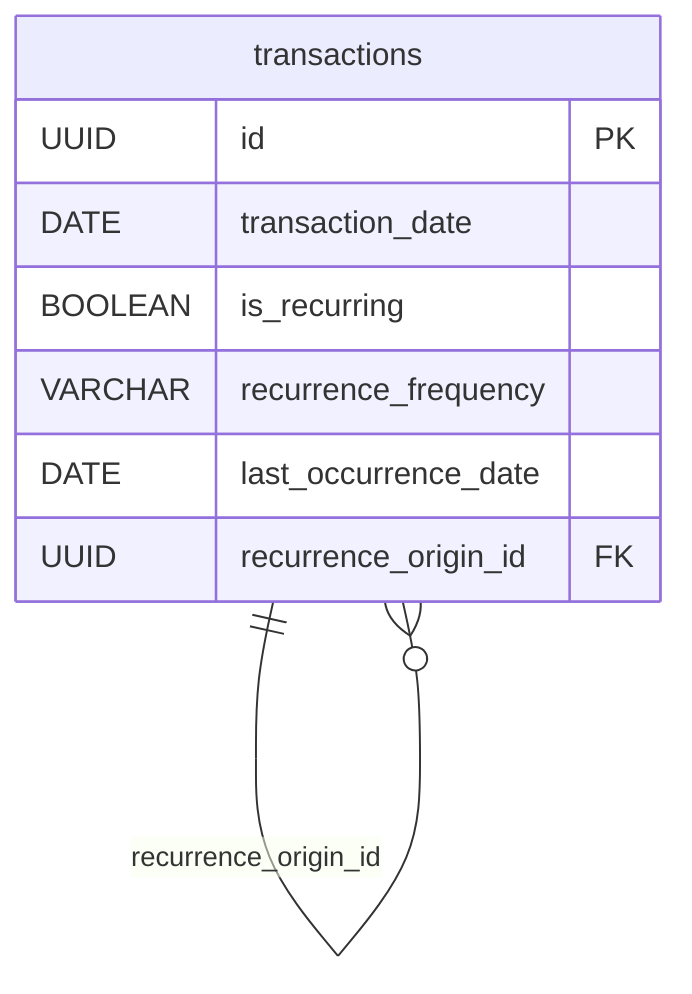

# finup-backend

API REST do projeto **FinUp** — AGES 2026/2.

Java 21 · Spring Boot 3.5 · Maven · PostgreSQL 16 · Docker

> O cadastro de usuário existe como **exemplo de referência** das convenções (veja a seção mais abaixo).
> A persistência está ligada: as entidades são `@Entity` e gravam no PostgreSQL do `docker compose`.
> A autenticação é o **AWS Cognito**: toda rota de `/api/v1` exige o access token do Cognito. Para
> desenvolver sem usuário no Cognito, existe o profile `mock-auth` (veja [Autenticação](#autenticação)).

---

## Pré-requisitos

- JDK 21
- Docker — **obrigatório**: o PostgreSQL sobe via `docker compose`, e a aplicação não inicia sem ele

Maven **não** precisa estar instalado: use o wrapper `./mvnw` (`mvnw.cmd` no Windows), que baixa a
versão correta na primeira execução. É a mesma versão usada pelo CI e pelo Dockerfile.

## Como rodar

São três passos, nesta ordem. Pular o primeiro ou o segundo faz a aplicação falhar no startup.

```bash
# 1. credenciais locais: copie o exemplo e defina DB_PASSWORD
cp .env.example .env

# 2. banco: PostgreSQL 16, com schema e carga inicial
docker compose up -d

# 3. aplicacao
./mvnw spring-boot:run
```

Antes do passo 3, preencha no `.env` `COGNITO_USER_POOL_ID` e `COGNITO_CLIENT_ID` — ou, sem
Cognito, use `SPRING_PROFILES_ACTIVE=dev,mock-auth`. Sem um dos dois a aplicação não sobe, com uma
mensagem dizendo que falta `finup.cognito.user-pool-id`. Detalhes em [Autenticação](#autenticação).

O `.env` **não** é opcional: `DB_PASSWORD` não tem valor padrão. Sem ele, ou com o banco fora do ar, a
aplicação morre com uma stack do Hibernate (`Unable to determine Dialect without JDBC metadata` ou
`password authentication failed`), nunca com uma mensagem dizendo que falta configuração.

Detalhes do banco — recriar, popular, ver logs — estão em [Banco de Dados com Docker](#banco-de-dados-com-docker).

Depois de subir:

| O quê | URL |
|---|---|
| Health check | http://localhost:8080/actuator/health |

### Alternativa: subir banco + API pelo Docker (para testar com o mobile)

O `docker-compose.yml` tem dois serviços: `db` e `app`. Para quem vai testar o cadastro pelo app
(em vez de só chamar a API local com `curl`/Postman), é mais simples subir os dois de uma vez, sem
`./mvnw spring-boot:run` à parte.

Antes de subir, defina no `.env` **como a aplicação vai autenticar** — os mesmos dois caminhos da
seção [Autenticação](#autenticação), porque o container roda a mesma aplicação:

| Caminho | O que preencher no `.env` | Como chamar a API |
|---|---|---|
| Com o Cognito (é o que o app mobile usa) | `COGNITO_USER_POOL_ID` e `COGNITO_CLIENT_ID` | `Authorization: Bearer <access token>` |
| Sem o Cognito, para teste local | `SPRING_PROFILES_ACTIVE=dev,mock-auth` | headers `X-Mock-Cognito-*` |

Sem um dos dois o container `app` **não sobe**: fora do profile `mock-auth` a aplicação exige as duas
variáveis do Cognito e falha na inicialização de propósito. Como o serviço tem `restart: unless-stopped`,
o sintoma é o container reiniciando em loop — `docker compose logs app` mostra, repetido a cada
tentativa:

```
APPLICATION FAILED TO START
Binding to target br.com.finup.config.CognitoProperties failed:
    Property: finup.cognito.userPoolId
    Reason: must not be blank
```

Com isso definido:

```bash
cp .env.example .env      # se ainda não tiver feito, e ajuste conforme a tabela acima
docker compose up -d --build
```

Isso builda a imagem da aplicação (a partir do `Dockerfile`) e sobe os dois containers juntos, com a
API já esperando o banco ficar `healthy` antes de iniciar.

> **Se você já rodou o `docker compose` antes:** o schema e a carga inicial de `database/init/` só são
> executados quando o volume do Postgres está vazio. Vindo de uma versão anterior do banco, o container
> sobe com o schema velho e os erros aparecem em SQL, não em configuração. Nesse caso, recrie o volume
> antes — veja [Apagar o banco local e começar do zero](#apagar-o-banco-local-e-começar-do-zero).

**Ponto de atenção ao testar com o app mobile na mesma rede:** o `CORS_ALLOWED_ORIGINS` do `.env`
só libera as origens já cadastradas (por padrão, `localhost` em algumas portas). Se o app mobile
estiver rodando em outra máquina/emulador acessando esta API pelo IP da rede local, adicione esse IP
à lista (ex.: `http://192.168.0.10:8081`) e recrie o container da aplicação para aplicar:

```bash
docker compose up -d app
```

Isso normalmente não é necessário para o app mobile nativo (Android/iOS) — CORS só se aplica a
requisições feitas por um navegador. É relevante apenas testando pela versão web do Expo
(`npm run web`, no repositório `finup-mobile`), que roda dentro de um navegador.

## Scalar / OpenAPI

Com a aplicação em execução fora do perfil `prod`, a referência da API fica disponível no Scalar:

| O quê | URL |
|---|---|
| Scalar API Reference | http://localhost:8080/docs |
| Swagger UI | http://localhost:8080/swagger-ui.html |
| Contrato OpenAPI | http://localhost:8080/v3/api-docs |

O Scalar e o Swagger UI leem o contrato OpenAPI gerado automaticamente pelo `springdoc` a partir dos
controllers e DTOs da aplicação. O Swagger UI continua disponível porque os roteiros de teste
abaixo usam o botão **Authorize** dele. Os metadados gerais da API ficam centralizados em
`config/OpenApiConfig.java`.

> A documentação interativa e o contrato JSON ficam desabilitados no perfil `prod`.

### Endpoints disponíveis hoje

Nenhum deles recebe identificador de usuário do cliente: quem está chamando vem sempre da
identidade autenticada — o header `Authorization: Bearer <access token do Cognito>`, ou os headers
`X-Mock-Cognito-*` no profile `mock-auth`. Sem identidade, a resposta é `401` (a única exceção é a
consulta de e-mail do cadastro, explicada abaixo da tabela). No Swagger, use o botão **Authorize**.

| Método e caminho | O que faz |
|---|---|
| `POST /api/v1/users/email-availability` | **público, sem token.** Diz se um e-mail já está cadastrado (`{"available": true\|false}`). Usado pelo formulário de cadastro |
| `POST /api/v1/users` | cria o registro local da identidade autenticada. Corpo vazio |
| `GET /api/v1/users/me` | devolve o usuário da identidade autenticada |
| `GET /api/v1/users/{id}` | devolve o próprio usuário (outro id dá `404`) |
| `PATCH /api/v1/users/me/additional-info` | grava as informações complementares (Etapas 2 e 3 do cadastro) |
| `POST /api/v1/users/me/finup-score/recalculate` | recalcula e persiste o FinUp Score |
| `GET /api/v1/categories` | categorias do usuário **e** as padrão do sistema |
| `POST /api/v1/categories` | cria categoria do usuário |
| `PUT /api/v1/categories/{id}` | edita categoria do usuário. Padrão do sistema devolve `403` |
| `DELETE /api/v1/categories/{id}` | remove categoria do usuário. Em uso devolve `409` |
| `POST /api/v1/transactions` | registra uma transação, avulsa ou abrindo uma série recorrente |
| `GET /api/v1/transactions?from=yyyy-MM-dd&to=yyyy-MM-dd` | lista as transações e o saldo do usuário no período informado |
| `GET /api/v1/payment-methods` | lista os meios de pagamento ativos do usuário |
| `POST /api/v1/ai/assistant` | interpreta um texto livre e executa a ação financeira correspondente |
| `GET /api/v1/assistant/conversations` | lista o histórico de conversas do usuário, ordenado pela atualização mais recente |
| `GET /api/v1/assistant/conversations/{id}/messages` | lista as mensagens de uma conversa do usuário em ordem cronológica |
| `GET /api/v1/admin/me` | **só grupo `admin`.** Devolve o administrador autenticado: `{"id", "name", "email", "role": "ADMIN"}` |

Tudo sob `/api/v1/admin/**` — o `GET /api/v1/admin/me` e os widgets do dashboard — exige que o
usuário esteja no grupo `admin` do Cognito. Token válido de quem não está no grupo responde `403`.
Veja [Painel administrativo](#painel-administrativo-grupo-admin-e-app-client-próprio).

Categoria e meio de pagamento referenciados por uma transação precisam ser do
próprio usuário — categoria padrão do sistema também vale. Referência de outro usuário responde
`404`, e não `403`: um `403` confirmaria a existência do id para quem não deveria saber dela.

A categoria também precisa ser **do mesmo tipo da transação**: categoria `EXPENSE` não classifica
uma receita, e vice-versa. Incompatibilidade responde `422`. A disponibilidade é verificada antes da
compatibilidade, de propósito: na ordem inversa, um `422` em categoria privada de outro usuário
confirmaria a existência daquele id — o mesmo vazamento que o `404` acima evita.

O dono da transação vem sempre da identidade autenticada. `userId` não faz parte do corpo do
`POST`; se o cliente enviar um, ele é ignorado.

**A consulta de e-mail é a exceção, de propósito.** O formulário de cadastro precisa avisar que o
e-mail já existe antes de a pessoa ter conta e token, então `POST /api/v1/users/email-availability`
é público e confirma se um e-mail está cadastrado. Isso permite sondar e-mails sem deixar rastro.
Ainda **não há limite de requisições**; ele precisa existir (por IP ou no gateway) antes de
produção. O e-mail vai no corpo, e não na URL, para não aparecer em log de acesso. A resposta é só
um aviso: só enxerga a tabela `users` e não reserva o e-mail, então o cadastro continua podendo
falhar com `409`.

O detalhe de cada campo está no Swagger — a tabela acima é só o mapa.

### Como documentar novos endpoints

O `springdoc` descobre automaticamente classes com `@RestController`. Use as anotações do pacote
`io.swagger.v3.oas.annotations` apenas para complementar o que não puder ser inferido pelos tipos
Java:

```java
@Operation(summary = "Lista as transações do usuário")
@ApiResponse(responseCode = "200", description = "Transações encontradas")
@GetMapping("/transactions")
public List<TransactionResponse> list() {
    // ...
}
```

Nos DTOs, `@Schema` pode esclarecer regras e fornecer exemplos de campos:

```java
public record TransactionResponse(
        @Schema(example = "42") Long id,
        @Schema(example = "125.90") BigDecimal amount
) {}
```

Evite anotar tudo: nomes claros e DTOs tipados já produzem boa parte do contrato. Depois de criar
ou alterar um endpoint, confira o resultado no Scalar e rode `./mvnw clean verify`.

## Como validar antes de abrir um PR

```bash
./mvnw clean verify
```

O mesmo comando roda no CI a cada Pull Request. Se falhar localmente, vai falhar lá.

`verify` inclui o **Spotless** (`google-java-format`). Se ele reprovar a formatação:

```bash
./mvnw spotless:apply
```

---

## Se o build falhar antes de compilar

### `PKIX path building failed` ao baixar dependências

```
Could not transfer artifact ... from/to central (https://repo.maven.apache.org/maven2):
PKIX path building failed: unable to find valid certification path to requested target
```

Alguma ferramenta de segurança na sua máquina está interceptando TLS: ela substitui o certificado
do Maven Central por um assinado por uma CA própria. O Windows confia nessa CA (por isso navegador
e `git` funcionam), mas o Java tem um *truststore* próprio, o `cacerts`, que não a conhece.

Para descobrir quem está interceptando:

```bash
openssl s_client -connect repo.maven.apache.org:443 -servername repo.maven.apache.org </dev/null 2>/dev/null | grep issuer=
```

**Correção (Windows)** — mandar o Java usar o truststore do Windows, que já confia na CA:

```powershell
setx MAVEN_OPTS "-Djavax.net.ssl.trustStoreType=Windows-ROOT"
```

Abra um terminal novo depois. Não é uma flag insegura: os certificados continuam sendo validados,
apenas contra a lista do sistema em vez da lista embutida no JDK.

> Isto **não** entra no `pom.xml` nem no `.mvn/jvm.config`: `Windows-ROOT` não existe em Linux nem
> em macOS e quebraria o CI e quem não usa Windows. É configuração de máquina, por isso vive aqui.

Em Linux/macOS, o equivalente é importar a CA com `keytool -importcert` num truststore próprio.

**Dentro do container, essa correção não vale.** O `MAVEN_OPTS` da sua máquina não atravessa o
`docker build`, e a imagem usa o `cacerts` do JDK, que não conhece a CA da ferramenta. Atrás de um
proxy TLS desses, então, o `docker compose up -d --build` tende a falhar em dois pontos: no
`dependency:go-offline` do build da imagem, e em runtime, nas chamadas da aplicação para o Cognito
(JWKS e `GetUser`). Resolver isso exige importar a CA no truststore da imagem, o que ainda não está
feito aqui — enquanto isso, nessas máquinas o caminho é o da seção [Como rodar](#como-rodar), com a
aplicação rodando fora do container.

### Spotless reprova arquivos que você não editou

Era falta de `.gitattributes` — já corrigido. O arquivo força **LF em todo o repositório**. Sem ele,
o resultado dependia do `core.autocrlf` de cada pessoa, e o mesmo código passava para uns e
reprovava para outros. Se você clonou antes disso, rode uma vez:

```bash
git add --renormalize .
./mvnw spotless:apply
```

### No Windows, use `mvnw.cmd`

Rodar `./mvnw` pelo Git Bash pode falhar ao instalar o Maven (`fail to move MAVEN_HOME`). Use
`.\mvnw.cmd` no PowerShell — é o script feito para Windows.

---

## Estrutura de pastas

```
src/main/java/br/com/finup/
├── FinUpApplication.java     ponto de entrada
├── config/                   classes @Configuration (Security, CORS, OpenAPI...)
├── controller/               @RestController — camada HTTP
├── service/                  @Service — regra de negócio
├── repository/               acesso a dados
├── model/                    entidades e enums do domínio
├── dto/                      objetos de entrada/saída da API
├── mapper/                   conversão entidade ↔ DTO
└── exception/                exceções de negócio e handler global
```

Cada pasta tem um `.gitkeep` com uma linha explicando o que vai dentro. **Apague o `.gitkeep` quando a pasta receber a primeira classe** — ele só existe porque o Git não versiona diretórios vazios.

### Responsabilidade de cada camada

- **controller** — recebe a requisição, valida o formato de entrada, delega ao service e devolve o DTO de resposta. Não contém regra de negócio nem acesso a banco.
- **service** — onde a regra de negócio vive. Não conhece HTTP: nada de `HttpServletRequest`, `ResponseEntity` ou código de status aqui.
- **repository** — acesso a dados, isolado do resto.
- **dto** — o que entra e o que sai da API. Entidade nunca é exposta diretamente no controller.
- **model** — o domínio propriamente dito.

### Convenções

- Todo endpoint recebe e devolve **DTO tipado**, nunca `Map<String, Object>` ou `ResponseEntity<?>`. O contrato OpenAPI só tem valor se os tipos forem concretos — é dele que web e mobile vão gerar seus clientes.
- Tratamento de erro centralizado no `exception/`, em formato único para toda a API — veja
  [Contrato de erro](#contrato-de-erro). Nunca monte resposta de erro dentro de um controller.
- Nada de credencial ou chave em código: use variáveis de ambiente (veja `.env.example`).

---

## Exemplo de referência: cadastro de usuário

O recurso `User` existe como **exemplo executável do padrão**. Ao criar uma feature nova, copie a
estrutura dele. Cada arquivo mostra a responsabilidade de uma camada:

| Arquivo | Papel |
|---|---|
| `controller/UserController.java` | recebe, `@Valid`, delega, escolhe o status. Sem `try/catch` |
| `service/UserService.java` | a regra (e-mail duplicado). Não conhece HTTP |
| `repository/UserRepository.java` | interface `JpaRepository` — é dela que o service depende |
| `model/User.java` | `@Entity`, com as invariantes do domínio |
| `security/AuthenticatedIdentityResolver.java` | de onde vem a identidade de quem chamou |
| `security/CognitoAuthenticatedIdentityResolver.java` | implementação real: `sub` do access token, e-mail e nome via `GetUser` |
| `security/MockAuthenticatedIdentityResolver.java` | implementação por header, só com o profile `mock-auth` |
| `dto/UpdateUserAdditionalInfoRequest.java` | entrada + validação + `@Schema` do OpenAPI |
| `dto/UserResponse.java` | saída. A entidade nunca é exposta |
| `mapper/UserMapper.java` | conversão entidade ↔ DTO |
| `exception/EmailAlreadyRegisteredException.java` | erro de negócio com o status que lhe cabe (409) |

Testes correspondentes, também de referência:

- `service/UserServiceTest.java` — unitário, Mockito, sem contexto Spring. É o formato padrão.
- `controller/UserControllerTest.java` — `@WebMvcTest`, só a camada web.

```bash
curl -X POST http://localhost:8080/api/v1/users -H "Authorization: Bearer $TOKEN"
```

O corpo é vazio: nome e e-mail vêm da identidade autenticada, não do cliente. Devolve `201` com
`Location`. Repetir a mesma chamada devolve `409`; sem token devolve `401`. Como obter o `$TOKEN`
está em [Autenticação](#autenticação).

### Idioma

**Identificador é código, em inglês. Prosa é conteúdo, em português.**

| | Idioma | Exemplo |
|---|---|---|
| Classes, métodos, variáveis, pacotes | inglês | `UserService.register()`, `existsByEmail` |
| Campos do JSON e caminhos da API | inglês | `/api/v1/users`, `{"name": …, "createdAt": …}` |
| Nome do método de teste | inglês | `rejectsDuplicateEmail()` |
| Javadoc e comentários | português | explicam a decisão para quem lê |
| `@DisplayName` e `@Schema` | português | o relatório de teste e o Swagger são para o time |
| **Mensagem que chega ao cliente** | **português** | `"Ja existe um usuario cadastrado…"`, `"deve ser um e-mail valido"` |

A regra é essa: se o texto vai ser lido por uma pessoa, português; se é um símbolo do código ou do
contrato, inglês. Em `record`, o nome do componente **é** o nome do campo JSON — por isso o
contrato acompanha o código.

### O que o exemplo estabelece

- **Versão no caminho desde o primeiro endpoint** (`/api/v1/...`). Adicionar versionamento depois
  que web e mobile já consomem a API custa muito mais caro.
- **Injeção por construtor com campo `final`** — nunca `@Autowired` em campo.
- **`record` para DTO**, classe para entidade.
- **Sufixo diz a camada**: `*Controller`, `*Service`, `*Repository`, `*Request`, `*Response`,
  `*Mapper`, `*Exception`. O nome do arquivo já responde onde ele mora.
- **Nada de `null` cruzando fronteira**: o repositório devolve `Optional`.
- **Erro é exceção**, não código de retorno. Quem traduz para HTTP é o handler global.

> O exemplo é deletável. Quando o cadastro real de usuário for implementado, ele substitui este —
> mas a estrutura permanece.

## Autenticação

A API valida o **access token** do AWS Cognito (Spring Security OAuth2 Resource Server). O token
precisa ser assinado pelo User Pool configurado, estar dentro da validade, ter `token_use=access` e
`client_id` igual a um dos App Clients configurados — o do app (`COGNITO_CLIENT_ID`) ou o do painel
(`COGNITO_ADMIN_CLIENT_ID`). O ID token é recusado, mesmo sendo do mesmo pool.

O access token só traz o `sub`. E-mail e nome, necessários só no cadastro (`POST /api/v1/users`),
o backend busca na API `GetUser` do Cognito usando o próprio token do usuário — sem credencial da
AWS. As demais rotas usam só o `sub`, sem chamada de rede.

| Classe | Papel |
|---|---|
| `config/SecurityConfig.java` | o que exige token, o que é público (Swagger, `/actuator/health`) e o que exige o papel `ADMIN` |
| `config/CognitoConfig.java` | valida assinatura, issuer, `token_use` e `client_id` |
| `security/CognitoAuthenticatedIdentityResolver.java` | monta a identidade a partir do token |
| `security/CognitoUserAttributesClient.java` | chama o `GetUser` do Cognito |
| `security/CognitoGroupsAuthoritiesConverter.java` | transforma o claim `cognito:groups` nos papéis da API (`security/Role.java`) |
| `security/ProblemDetailAuthenticationEntryPoint.java` | 401 em RFC 7807, no mesmo formato do resto da API |
| `security/ProblemDetailAccessDeniedHandler.java` | 403 em RFC 7807, quando o token é válido mas falta o papel |

### O que pegar no console da AWS

> **Nomes no console em português.** O console chama o *User Pool* de **Grupo de usuários** e o
> *Group* de **Grupo**, e são coisas diferentes. O pool é o cadastro de todos os usuários do FinUp —
> um só, o do `COGNITO_USER_POOL_ID`. Os grupos e os clientes da aplicação ficam **dentro** dele.
> Quando a diferença importa, este README usa os nomes em inglês.

Em **Cognito → Grupos de usuários → (o pool do FinUp)**:

| Informação | Onde | Vai para o `.env` |
|---|---|---|
| ID do grupo de usuários (`us-east-2_AbCdEf123`) | página *Visão geral* do pool | `COGNITO_USER_POOL_ID` |
| ID do cliente do app | *Clientes da aplicação → FinUp* (página de detalhes, não a de edição) | `COGNITO_CLIENT_ID` |
| ID do cliente do painel | *Clientes da aplicação →* o cliente do painel | `COGNITO_ADMIN_CLIENT_ID` |

A região vem do prefixo do ID do pool — não há variável para ela. Nos dois clientes da aplicação,
confira:

- **Segredo do cliente vazio.** São clientes públicos (app mobile e painel web), que não guardam
  segredo. Com segredo, o login pelo terminal abaixo falha — e o Cognito não deixa remover o
  segredo de um cliente que já existe: é preciso criar outro.
- **Fluxos de autenticação:** `ALLOW_USER_AUTH`, `ALLOW_USER_SRP_AUTH` e `ALLOW_REFRESH_TOKEN_AUTH`.
  **Não** é preciso habilitar `ALLOW_USER_PASSWORD_AUTH`: o teste abaixo usa o `ALLOW_USER_AUTH`.

Como o pool do FinUp foi criado (e nada disso muda depois de criado):

- o login é por **nome de usuário, com o e-mail como alias** — o `Username` do cadastro **não pode
  ter formato de e-mail** (`Username cannot be of email format`). O login pelo e-mail só funciona
  depois que o e-mail for confirmado pelo código;
- **`birthdate` é atributo obrigatório** no cadastro do Cognito, no formato `AAAA-MM-DD`.

### Painel administrativo: grupo `admin` e App Client próprio

O painel web usa o **mesmo User Pool** do app — não existe um pool para o painel. Dentro do pool,
duas peças são do painel: o grupo `admin` e um App Client só dele.

```
User Pool do FinUp (no console: "Grupo de usuários")
├── Usuários                     todos, do app e do painel
├── Grupos
│   ├── admin                    administradores do painel
│   └── outros, ex.: Customers   a API ignora
└── Clientes da aplicação
    ├── FinUp                    app mobile → COGNITO_CLIENT_ID
    └── cliente do painel        painel web → COGNITO_ADMIN_CLIENT_ID
```

| Regra | Onde |
|---|---|
| `/api/v1/admin/**` exige o papel `ADMIN` | `config/SecurityConfig.java` |
| grupo `admin` do Cognito → papel `ADMIN` | `security/CognitoGroupsAuthoritiesConverter.java`, a partir do claim `cognito:groups` do access token |
| sem token ou token inválido → `401`; token válido sem o grupo → `403` | os dois em `application/problem+json` |

O que decide o acesso é o **grupo do usuário**, não o App Client: a API aceita o token dos dois
clientes em todas as rotas, e o `client_id` só diz por qual aplicação a pessoa entrou. O cliente
do painel existe para o painel ter configuração própria — principalmente a validade do token,
veja abaixo — e poder ser desligado sem afetar o app. O scope `aws.cognito.signin.user.admin`, que
vem em todo access token do Cognito, também **não** é o grupo `admin`: ele só autoriza o usuário a
ler os próprios atributos.

O repositório não tem infraestrutura como código do Cognito. Em cada ambiente, confira em
**Cognito → Grupos de usuários → (o pool do FinUp)**:

1. **Grupos:** um grupo chamado exatamente `admin` (minúsculas: o Cognito diferencia `admin` de
   `Admin` e de `admins`). Se não existir, *Criar grupo*, sem função do IAM.
2. **Clientes da aplicação:** um cliente para o painel, do tipo aplicação de página única (SPA),
   **sem segredo do cliente**. Fluxos de autenticação: `ALLOW_USER_SRP_AUTH` e
   `ALLOW_REFRESH_TOKEN_AUTH`, que o painel usa, e `ALLOW_USER_AUTH`, que o login pelo terminal
   deste README usa. Se o painel usar a página de login hospedada, cadastre a URL do painel como
   URL de retorno e habilite o scope `aws.cognito.signin.user.admin`, senão o `POST /api/v1/users`
   do passo 6 responde `401`.
3. **Validade do token de acesso** do cliente do painel: reduza para, por exemplo, 15 minutos (o
   mínimo é 5). É ela que limita quanto tempo alguém tirado do grupo continua com acesso — veja
   abaixo. O refresh token renova a sessão sem pedir login de novo.
4. **Grupos → admin → Adicionar usuário**, para cada administrador.
5. No ambiente da API, preencha `COGNITO_ADMIN_CLIENT_ID` com o ID do cliente do painel e inclua a
   origem do painel em `CORS_ALLOWED_ORIGINS`.
6. No primeiro acesso, o painel chama `POST /api/v1/users` para criar o registro local do
   administrador. Sem ele, `GET /api/v1/admin/me` responde `404`: o `id` devolvido é o do usuário
   local, o mesmo de `GET /api/v1/users/me`.

O mesmo pela AWS CLI, para quem tem credencial com permissão no pool:

```bash
aws cognito-idp create-group --user-pool-id <pool id> --group-name admin \
  --description "Administradores do painel FinUp"

aws cognito-idp create-user-pool-client --user-pool-id <pool id> --client-name finup-painel \
  --no-generate-secret \
  --explicit-auth-flows ALLOW_USER_AUTH ALLOW_USER_SRP_AUTH ALLOW_REFRESH_TOKEN_AUTH

aws cognito-idp admin-add-user-to-group --user-pool-id <pool id> \
  --username <username> --group-name admin
```

Dois comportamentos do Cognito que valem saber:

- O grupo entra no token **na hora do login**. Quem acabou de ser adicionado ao grupo precisa
  entrar de novo (ou renovar o token) para o `403` virar `200`.
- Pelo mesmo motivo, **tirar alguém do grupo não derruba o acesso na hora**: o access token já
  emitido continua valendo até expirar. A API valida o token sozinha (assinatura e validade), sem
  consultar o Cognito a cada requisição — por isso **revogar as sessões do usuário no console
  também não derruba esse token**: só impede que ele obtenha tokens novos. O que limita a janela é
  a validade do token de acesso do cliente do painel (passo 3).

Com o profile `mock-auth` não há grupo: as rotas de admin ficam abertas a qualquer identidade
simulada. É só para desenvolvimento, e esse profile não sobe em produção.

### Rodar a API contra o Cognito

A API busca as chaves públicas do pool e chama o `GetUser` da AWS. Numa máquina com TLS
interceptado (o mesmo caso do `PKIX path building failed` acima), o Java da **aplicação** também
precisa do truststore do Windows — o `MAVEN_OPTS` vale só para o Maven, não para a aplicação que ele
inicia:

```bash
./mvnw spring-boot:run "-Dspring-boot.run.jvmArguments=-Djavax.net.ssl.trustStoreType=Windows-ROOT"
```

Sem isso, token válido volta `401` e o cadastro volta `503`, com `PKIX` no log.

### Testar o cadastro de ponta a ponta

Use um e-mail que você consiga abrir (o código de confirmação chega nele) e uma senha descartável.
No Gmail, `seu.email+finup1@gmail.com` cai na sua caixa e conta como outro usuário para o Cognito.
Nos comandos abaixo, `<regiao>` é o prefixo do ID do pool (ex.: `us-east-2`).

1. Crie o usuário no pool (a API de cadastro do Cognito não exige credencial da AWS):

   ```bash
   curl -s -X POST "https://cognito-idp.<regiao>.amazonaws.com/" \
     -H "Content-Type: application/x-amz-json-1.1" \
     -H "X-Amz-Target: AWSCognitoIdentityProviderService.SignUp" \
     -d '{"ClientId":"<client id>","Username":"ana-teste","Password":"<senha>",
          "UserAttributes":[{"Name":"email","Value":"ana@exemplo.com"},
                            {"Name":"name","Value":"Ana Souza"},
                            {"Name":"birthdate","Value":"2000-05-20"}]}'
   ```

2. Confirme a conta com o código que chegou por e-mail (ou no console: *Usuários → o usuário →
   Ações → Confirmar conta*):

   ```bash
   curl -s -X POST "https://cognito-idp.<regiao>.amazonaws.com/" \
     -H "Content-Type: application/x-amz-json-1.1" \
     -H "X-Amz-Target: AWSCognitoIdentityProviderService.ConfirmSignUp" \
     -d '{"ClientId":"<client id>","Username":"ana-teste","ConfirmationCode":"<codigo>"}'
   ```

3. Faça login e copie o `AuthenticationResult.AccessToken` da resposta (não o `IdToken`):

   ```bash
   curl -s -X POST "https://cognito-idp.<regiao>.amazonaws.com/" \
     -H "Content-Type: application/x-amz-json-1.1" \
     -H "X-Amz-Target: AWSCognitoIdentityProviderService.InitiateAuth" \
     -d '{"AuthFlow":"USER_AUTH","ClientId":"<client id>",
          "AuthParameters":{"USERNAME":"ana-teste","PREFERRED_CHALLENGE":"PASSWORD","PASSWORD":"<senha>"}}'
   ```

4. Chame a API com o token (ou cole no **Authorize** do Swagger):

   ```bash
   curl -X POST http://localhost:8080/api/v1/users -H "Authorization: Bearer $TOKEN"   # 201
   curl http://localhost:8080/api/v1/users/me -H "Authorization: Bearer $TOKEN"        # 200
   ```

   Repetir o `POST` devolve `409`. O access token vale 1 hora; depois disso a API devolve `401` e é
   preciso repetir o passo 3.

No Windows, se o `curl` falhar com `CRYPT_E_NO_REVOCATION_CHECK`, acrescente `--ssl-no-revoke`.

### Testar o acesso de admin pelo Swagger

Com a API rodando contra o Cognito e `COGNITO_ADMIN_CLIENT_ID` preenchido, use um usuário que já
exista no pool — não é preciso criar outro:

1. Pegue o access token como no passo 3 de
   [Testar o cadastro](#testar-o-cadastro-de-ponta-a-ponta), com o ID do **cliente do painel**.
2. No Swagger, **Authorize** → cole o token, sem a palavra `Bearer` → execute
   `GET /api/v1/admin/me`.
3. Para mudar a situação do usuário, coloque-o no grupo ou tire-o dele em **Grupos → admin**,
   no console, e faça login de novo.

| Situação | Resposta |
|---|---|
| sem token, ou com o ID token no lugar do access token | `401` |
| usuário fora do grupo `admin` | `403` |
| usuário no grupo, mas com token emitido antes de entrar nele | `403` — faça login de novo |
| no grupo, sem registro local nesta base | `404` — execute `POST /api/v1/users` uma vez |
| no grupo, com registro local | `200` `{"id", "name", "email", "role": "ADMIN"}` |
| tirado do grupo, ainda com o token antigo | `200` até o token expirar |

### Sem Cognito: profile `mock-auth`

Com `SPRING_PROFILES_ACTIVE=dev,mock-auth`, a API não exige token e a identidade vem dos headers
`X-Mock-Cognito-Sub` (obrigatório), `X-Mock-Cognito-Email` (obrigatório) e `X-Mock-Cognito-Name`
(opcional). As variáveis do Cognito deixam de ser necessárias.

```bash
curl -X POST http://localhost:8080/api/v1/users -H 'X-Mock-Cognito-Sub: mock-sub-ana' -H 'X-Mock-Cognito-Email: ana@exemplo.com' -H 'X-Mock-Cognito-Name: Ana Souza'
```

O mock nunca vale em produção: com `prod` ativo, `mock-auth` é ignorado e a aplicação não sobe
sem um resolver de identidade.

## Contrato de erro

Todo erro da API sai em **RFC 7807** (`application/problem+json`), montado pelo
`ApiExceptionHandler` (`exception/`). O controller não trata erro: o service lança
`BusinessException` (ou uma subclasse, como `ResourceNotFoundException`) e o handler traduz.

Recurso inexistente **ou pertencente a outro usuário** responde `404` em `GET /api/v1/users/{id}`,
`PUT`/`DELETE /api/v1/categories/{id}` e
`GET /api/v1/assistant/conversations/{id}/messages`. A mesma regra vale para as referências de
categoria e meio de pagamento em `POST /api/v1/transactions`. A resposta não informa se o ID existe
nem inclui dados do recurso alheio. O `403` para operações proibidas sobre categoria padrão do
sistema (visível a todos) e o `401` para falhas de autenticação permanecem inalterados.

O `401` (token ausente, inválido ou expirado) e o `403` de `/api/v1/admin/**` (token válido de quem
não está no grupo `admin`) são devolvidos pelo Spring Security, antes de chegar a qualquer
controller, e saem no mesmo formato: `status`, `detail`, `timestamp` e `traceId`. O `detail` é
genérico de propósito — não diz por que o token foi recusado nem qual grupo falta.

```json
{
  "type": "https://finup.com.br/erros/validacao",
  "title": "Requisicao invalida",
  "status": 400,
  "detail": "Um ou mais campos estao invalidos.",
  "timestamp": "2026-09-01T18:22:31.004Z",
  "traceId": "3f9c1e2a-8d47-4a91-9b0e-27c5d6f81a33",
  "campos": [
    { "campo": "valor", "mensagem": "deve ser maior que 0" }
  ]
}
```

`traceId` vai na resposta **e** no log. Erro inesperado nunca devolve a mensagem original ao
cliente — só o `traceId` para localizar no log.

## Configuração por ambiente

Nenhum valor de ambiente fica em código. O `application.yml` lê variáveis com default de
desenvolvimento (veja `.env.example`):

| Variável | Default | Para quê |
|---|---|---|
| `SERVER_PORT` | `8080` | porta HTTP |
| `SPRING_PROFILES_ACTIVE` | `dev` | perfil ativo; use `prod` no ambiente implantado |
| `LOG_LEVEL` | `DEBUG` no perfil `dev`, `INFO` fora dele | nível de log de `br.com.finup` |
| `CORS_ALLOWED_ORIGINS` | `http://localhost:5173` | origens do CORS, separadas por vírgula. O `.env.example` acrescenta `http://localhost:8081`, o Expo Web do `finup-mobile`, usado como fallback de teste do cadastro no navegador. Em produção, é a origem do painel. `*` não é aceito em nenhum ambiente: a aplicação não sobe |
| `DB_NAME` | `finup` | nome do banco |
| `DB_USER` | `finup_user` | usuário do banco |
| `DB_PASSWORD` | **sem default** | senha do banco; sem ela a aplicação não sobe |
| `DB_PORT` | `5432` | porta publicada pelo container do PostgreSQL |
| `DB_HOST` | `localhost` | host do banco; rodando `./mvnw spring-boot:run` mantenha `localhost` — no `docker compose up -d --build` o serviço `app` já sobrescreve para `db` (nome do serviço do Postgres na mesma rede do compose) |
| `COGNITO_USER_POOL_ID` | **sem default** | ID do grupo de usuários (`us-east-2_AbCdEf123`); a região sai do prefixo. Dispensado com `mock-auth` |
| `COGNITO_CLIENT_ID` | **sem default** | ID do App Client do app mobile (sem client secret). Dispensado com `mock-auth` |
| `COGNITO_ADMIN_CLIENT_ID` | vazio | ID do App Client do painel web, no mesmo User Pool (sem client secret). Vazio, só o token do app é aceito e o painel recebe `401` |

O `application.yml` importa o `.env` da raiz (`spring.config.import: optional:file:.env[.properties]`),
então o mesmo arquivo serve para o `docker compose` e para a aplicação rodando via `./mvnw`. O `optional:`
faz o Boot não reclamar da ausência do arquivo — mas a falta de `DB_PASSWORD` derruba o startup mesmo assim,
porque essa é a única variável sem valor padrão.

## O que ainda não está aqui (e por quê)

Não há mais dependência comentada no `pom.xml`. Já **entraram**: JPA e o driver do PostgreSQL,
com o banco em `docker compose`, e o Spring Security, com o Cognito. Uma ressalva sobre esse estado:

- **Não há ferramenta de migration.** Os scripts de `database/init/` só rodam quando o volume é criado,
  então hoje mudar o schema exige `docker compose down -v` e perder o banco local. Flyway continua
  pendente e vai precisar entrar antes de o schema começar a evoluir de verdade.

Os pacotes por funcionalidade (transações, score, trilhas, IA...) serão criados conforme cada feature entrar em sprint — não foram criados antecipadamente porque o escopo ainda está em discussão.

---

## Estrutura de suporte

```
.mvn/ + mvnw + mvnw.cmd       Maven Wrapper — não precisa de Maven instalado
.github/
├── workflows/ci.yml          build + formatação + testes em todo PR
├── dependabot.yml            atualização semanal de dependências
├── PULL_REQUEST_TEMPLATE.md  template de descrição de PR
└── CODEOWNERS                revisão obrigatória em controller/, dto/, contracts/ e build
Dockerfile                    build multi-stage, runtime sem root
.dockerignore                 o que fica fora do contexto de build
.editorconfig                 alinha o editor com o google-java-format
.env.example                  variáveis de ambiente esperadas
```

O `CODEOWNERS` só tem efeito com **"Require review from Code Owners"** ligado na branch
protection — sem isso o GitHub ignora o arquivo em silêncio.

Sobre o `Dockerfile`: ele monta a imagem da aplicação, é usado pelo CI e é o build do serviço `app`
do `docker-compose.yml`. Rodar essa imagem **fora** do compose não funciona para desenvolvimento
local: o `spring.datasource.url` cai no default `localhost`, e dentro do container `localhost` é o
próprio container, não o host onde o PostgreSQL está publicado. No compose isso se resolve porque o
serviço `app` define `DB_HOST=db`, o nome do serviço do Postgres na mesma rede. São dois caminhos
válidos, então: tudo em container, pela seção
[Alternativa: subir banco + API pelo Docker](#alternativa-subir-banco--api-pelo-docker-para-testar-com-o-mobile),
ou banco em container e aplicação na sua máquina, pela seção [Como rodar](#como-rodar).

## Banco de Dados com Docker

O projeto utiliza PostgreSQL 16 executado via Docker Compose para o ambiente local.

### Configuração

Crie um arquivo `.env` na raiz do projeto com base no `.env.example`.

Exemplo:

```env
SERVER_PORT=8080
SPRING_PROFILES_ACTIVE=dev
LOG_LEVEL=DEBUG
CORS_ALLOWED_ORIGINS=http://localhost:5173

DB_NAME=finup
DB_USER=finup_user
DB_PASSWORD=sua_senha_local
DB_PORT=5432
```

O arquivo `.env` não deve ser versionado, pois pode conter informações sensíveis.

### Subir o banco

```bash
docker compose up -d
```

### Verificar se o banco está funcionando

```bash
docker compose ps
```

O container do PostgreSQL deve aparecer em execução e com status `healthy`.

### Visualizar os logs do PostgreSQL

```bash
docker compose logs db
```

### Parar o ambiente

```bash
docker compose down
```

Os dados permanecem armazenados no volume Docker.

### Recriar o container

```bash
docker compose up -d --force-recreate
```

### Apagar o banco local e começar do zero

```bash
docker compose down -v
docker compose up -d
```

> Atenção: o comando `docker compose down -v` remove o volume do PostgreSQL e apaga os dados armazenados localmente.

### Configuração padrão do banco

- Banco: PostgreSQL 16
- Host: localhost
- Porta: 5432
- Nome do banco: finup
- Usuário: finup_user

A senha deve ser definida localmente através da variável `DB_PASSWORD`.

### Conexão com o backend

O Docker Compose utiliza as variáveis definidas no `.env`.

Ao executar o Spring Boot diretamente, o `.env` precisa existir na raiz: o `application.yml` o importa
via `spring.config.import`. `DB_NAME`, `DB_USER` e `DB_PORT` têm valor padrão no `application.yml`, mas
**`DB_PASSWORD` não tem** — sem ele a aplicação não sobe. O banco também precisa estar de pé
(`docker compose up -d`) antes de iniciar o backend, porque o JPA abre conexão durante o startup.

Nos dois casos a falha aparece como uma stack do Hibernate
(`Unable to determine Dialect without JDBC metadata`), e não como uma mensagem de configuração faltando.

A conexão local com o PostgreSQL utiliza o formato:

```text
jdbc:postgresql://localhost:5432/finup
```

## Inicialização e população do banco de dados

Os scripts SQL responsáveis pela criação e população do banco ficam em:

`database/init`

Eles são executados automaticamente pelo PostgreSQL durante a criação inicial do banco.

### Ordem de execução

1. `01-schema.sql` - cria a estrutura, as tabelas e os relacionamentos do banco.
2. `02-required-data.sql` - insere os dados obrigatórios da aplicação.
3. `03-test-data.sql` - insere dados fictícios para desenvolvimento e testes.

### Recriar e popular o banco novamente

Os scripts de inicialização são executados quando o PostgreSQL cria um novo volume.

Para remover o banco local e executar novamente todos os scripts:

```bash
docker compose down -v
docker compose up -d
```

Para acompanhar a execução dos scripts:

```bash
docker compose logs db
```

### Fluxo de inicialização

Ao criar o banco pela primeira vez, o processo ocorre na seguinte ordem:

1. O PostgreSQL é inicializado.
2. O arquivo `01-schema.sql` cria as tabelas e os relacionamentos.
3. O arquivo `02-required-data.sql` insere os dados obrigatórios.
4. O arquivo `03-test-data.sql` insere os dados fictícios de desenvolvimento e testes.
5. O banco fica disponível para utilização pela aplicação.

### Recorrência de transações

**Decisão:** a recorrência fica na própria tabela `transactions`, e não numa entidade separada.
Foi alinhada com o Willian e substitui a tabela `transaction_recurrences` e os endpoints
`/api/v1/transaction-recurrences`, que saíram. O motivo é a simplicidade: por enquanto só existe a
periodicidade mensal, e a próxima ocorrência sai da última ocorrência mais a periodicidade.

Colunas de recorrência em `transactions`:

| Coluna | Na transação que abre a série | Na ocorrência gerada | Na transação avulsa |
|---|---|---|---|
| `is_recurring` | `TRUE` | `FALSE` | `FALSE` |
| `recurrence_frequency` | `MONTHLY` | `NULL` | `NULL` |
| `last_occurrence_date` | data da última ocorrência gerada | `NULL` | `NULL` |
| `recurrence_origin_id` | `NULL` | `id` da transação que abriu a série | `NULL` |



Regras:

- A transação que abre a série é a primeira ocorrência. No cadastro, o backend preenche
  `last_occurrence_date` com o `transaction_date`, e o cliente só informa `isRecurring` e
  `recurrenceFrequency`.
- O **dia de referência** da série é o dia do `transaction_date` da transação que a abriu.
- **Próxima ocorrência** (mensal): o mês seguinte ao de `last_occurrence_date`, no dia de
  referência, ou no último dia do mês quando esse dia não existe nele. Uma série do dia 31 cai em
  28/02 e volta ao dia 31 em março. O cálculo fica em `Transaction.nextOccurrenceDate()`, e a API
  devolve o resultado em `nextOccurrenceDate`.
- Cada ocorrência gerada é uma transação nova, não recorrente, que aponta para a transação
  original por `recurrence_origin_id`. Quem gerar a ocorrência também avança o
  `last_occurrence_date` da original. **A geração em si ainda não existe**: esta modelagem só a
  prepara.

Constraints:

- `chk_transactions_recurrence`: com `is_recurring = TRUE`, a periodicidade e a última ocorrência
  são obrigatórias; com `FALSE`, as duas ficam nulas.
- `chk_transactions_recurrence_origin`: só uma transação não recorrente pode ser ocorrência gerada,
  e nunca de si mesma.
- `fk_transactions_recurrence_origin`: a transação original precisa existir.
- `uq_transactions_recurrence_occurrence`: no máximo uma ocorrência por série e data. Isso impede
  gerar o mesmo mês duas vezes, se a geração rodar de novo.

Exemplo: uma conta de luz cadastrada em `2026-09-05` com `MONTHLY` fica com
`last_occurrence_date = 2026-09-05` e `nextOccurrenceDate = 2026-10-05`.

Ainda não existe como encerrar uma série (data de término ou cancelamento): fica para uma próxima
tarefa.
